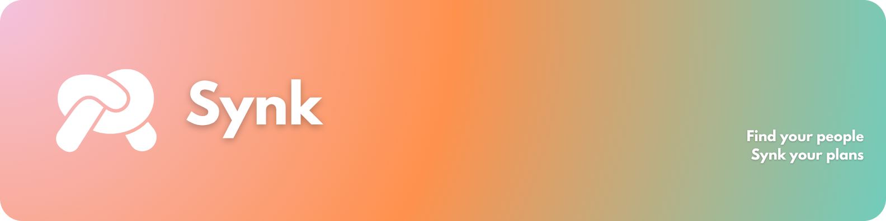
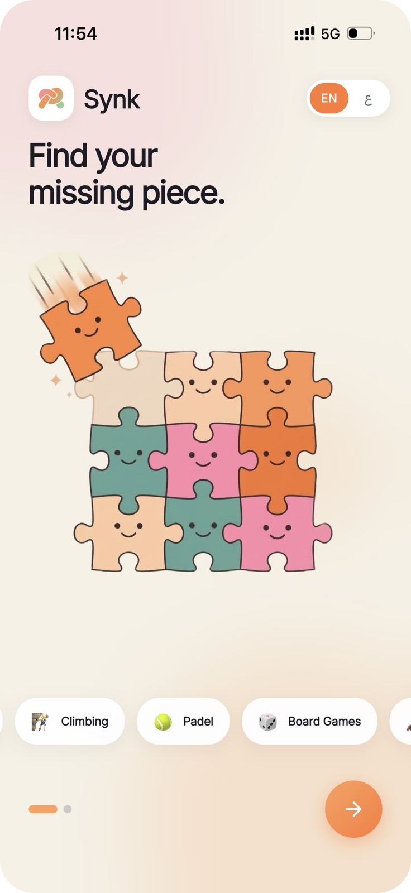
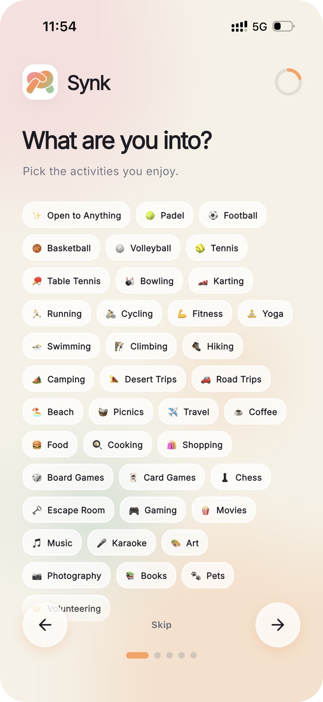
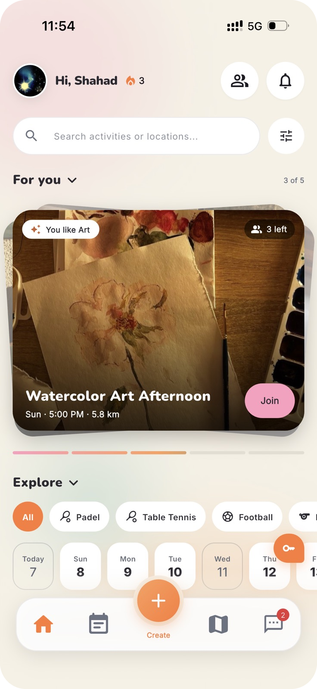
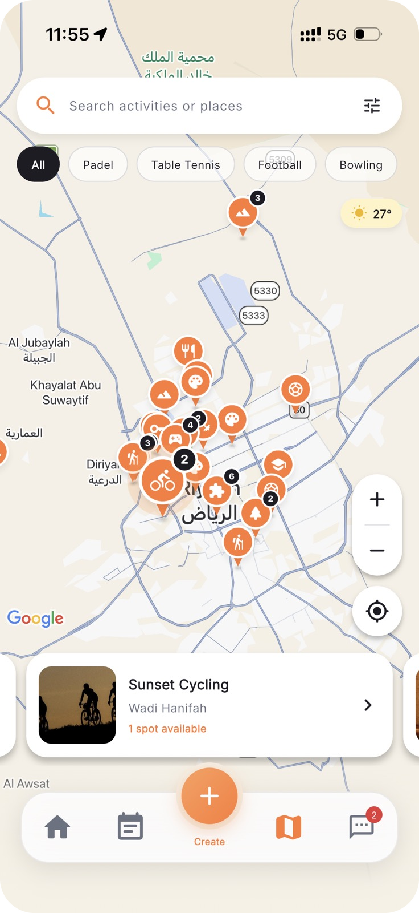
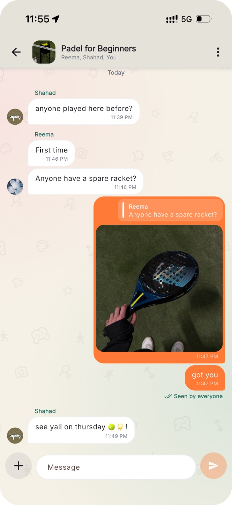

# Synk

<p align="center">
  
</p>

<p align="center">
  
  
  
  
  
</p>

---

Synk helps people in Riyadh find others who are into the same things, whether that's padel, board games or a jewelry workshop, and actually meet up. We built it for **SWE 444** @ KSU.

<p align="center">
  <a href="https://synk.cc"></a>
</p>

<p align="center">Grab it for Android or iPhone at <a href="https://synk.cc"><b>synk.cc</b></a></p>

## What You Can Do

- **Find your thing:** padel tonight, a board game night this weekend, a pottery class next week. Top Picks shows what fits you
- **See what's around you:** open the map and see what's happening near you in Riyadh
- **Show up, or start your own:** join in one tap, or post your own plan and let people come to you
- **Talk before you meet:** every activity gets a group chat, so you're not walking in as a stranger
- **Make it stick:** add the people you liked and plan the next one together

Works in Arabic and English. See everything in [docs/FEATURES.md](docs/FEATURES.md).

## Screenshots

<p align="center">
  
  
  
  
  
</p>

## Built With

| | |
| :--- | :--- |
| App | Flutter and Dart |
| Backend | Supabase (Auth, Postgres, Storage, Edge Functions) |
| Maps and places | Google Maps and Google Places |
| Notifications | Firebase Cloud Messaging, ntfy, Telegram |
| Weather | Open-Meteo |
| Web pages and admin | HTML, CSS and JS on Vercel |

## Project Structure

```text
synk/
├── lib/                    Flutter app
├── supabase/
│   ├── functions/          Edge functions
│   └── migrations/         Database schema and RPCs
├── landing/                Web pages and admin dashboard
├── test/                   Tests
└── docs/                   Guides
```

## Getting Started

### 1. Prerequisites

- Flutter SDK
- Android Studio with an emulator or a phone
- A Supabase project with the migrations in `supabase/migrations` applied

On iPhone? Check [docs/IOS_SETUP.md](docs/IOS_SETUP.md).

### 2. Install

```bash
git clone https://github.com/shhdll/Synk.git
cd Synk
flutter pub get
```

### 3. Environment

```bash
cp .env.example .env
```

```env
SUPABASE_URL=your_supabase_project_url
SUPABASE_ANON_KEY=your_supabase_publishable_key
```

Use the publishable key here. Never put a service-role key in the app.

### 4. Keys

| File | What it holds | Where to get it |
| :--- | :--- | :--- |
| `android/local.properties` | `MAPS_API_KEY` for Android | [Google Cloud](https://console.cloud.google.com/apis/credentials) |
| `ios/Flutter/Secrets.xcconfig` | `MAPS_API_KEY` for iOS | [Google Cloud](https://console.cloud.google.com/apis/credentials) |
| `android/app/google-services.json` | Firebase config for push notifications | [Firebase](https://console.firebase.google.com/) |

### 5. Run

```bash
flutter devices
flutter run -d <device-id>
```

<details>
<summary>Setting up Supabase</summary>

```bash
supabase link --project-ref <project-ref>
supabase db push
supabase functions deploy --use-api
```

Add `io.supabase.synk://reset-password` and `io.supabase.synk://login-callback` as redirect URLs, then set these secrets:

| Secret | Used by |
| :--- | :--- |
| `GOOGLE_PLACES_API_KEY` | `places-proxy` |
| `FCM_SERVICE_ACCOUNT_JSON`, `PROMOTION_WEBHOOK_SECRET` | `notify-waitlist-promotion` |
| `RESEND_API_KEY`, `SUPPORT_FROM_EMAIL`, `SUPPORT_INBOX_EMAIL`, `SUPPORT_REPLY_URL` | `submit-support`, `reply-support`, `request-admin` |
| `TELEGRAM_BOT_TOKEN`, `TELEGRAM_WEBHOOK_SECRET` | `telegram-webhook` |

</details>

## Tests

```bash
flutter test      # unit and widget tests
flutter analyze   # static analysis
```

They cover things like sign-up checks, activity status, filters, search, Top Picks, the weekly streak, ratings and translations.
